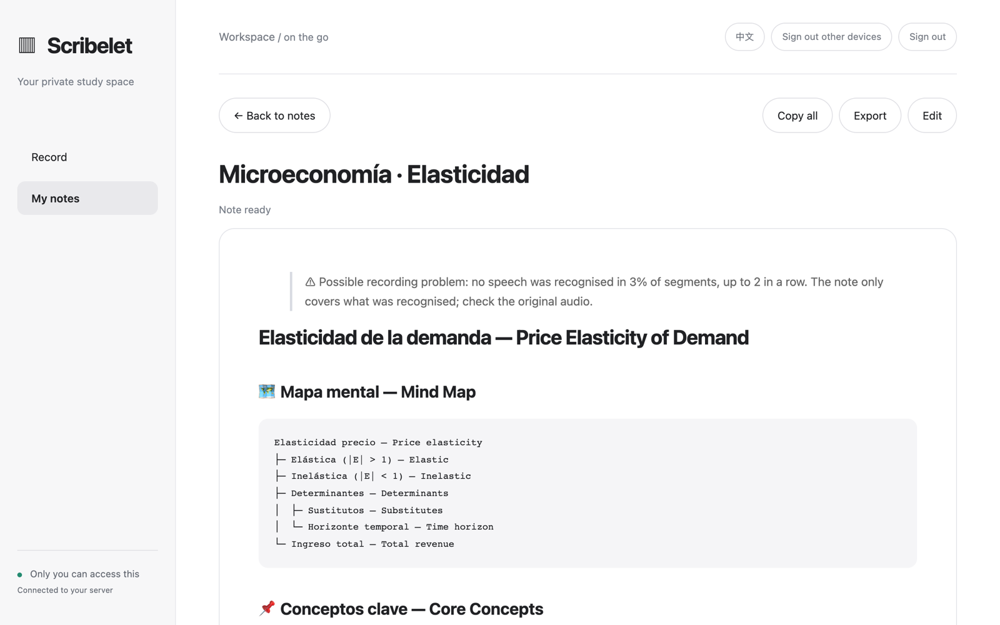
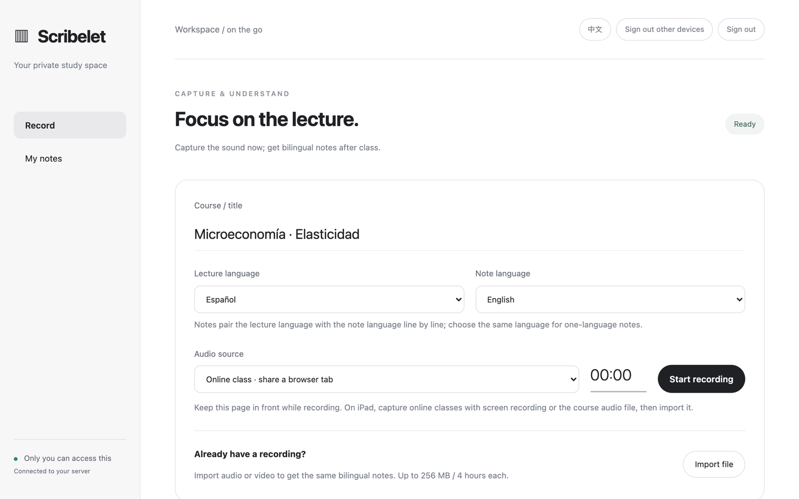

<div align="center">

# Scribelet

**Record the lecture. Get bilingual study notes. Keep everything on your own server.**

A self-hosted lecture recorder for anyone studying in a language that isn't their first.<br>
It records in the browser without losing a minute, then turns the class into bilingual notes you can actually revise from: Spanish → English, English → Chinese, Japanese → Korean, any pair of 10 major languages.

[中文说明](README.zh-CN.md) · [Quick start](#quick-start) · [How it works](#how-it-works) · [Roadmap](#roadmap)



</div>

---

## Why this exists

You are three weeks into a course taught in a language you're still learning. The lecture moves fast, the slides skip the reasoning, and by the time you have looked up one term the professor is two ideas ahead.

Recording apps give you a wall of text in the lecture's language. Translation apps give you a wall of text in yours. Neither gives you what you need the night before the exam: **the structure of the lecture, the key ideas in both languages, and a way to jump back to the exact minute you didn't understand.**

Scribelet does that. It also assumes the things that go wrong will go wrong: the hotel Wi-Fi drops, the laptop sleeps, the API runs out of quota halfway through a three-hour seminar. None of those should cost you a lecture.

## What you get after class

Every recording becomes one note with:

- **A mind map of the whole lecture** — every branch in both languages
- **Core concepts** — definitions, examples and explanations, each paired line by line
- **Framework / process** — steps, when they apply, and the usual mistakes
- **Exam watch** — likely questions with short answers in both languages
- **Timeline** — timestamps to find the part you want to hear again
- **To verify** — anything the model was unsure of, flagged instead of made up
- **The full transcript**, segment by segment, with its translation under each line

If part of the recording had no usable speech, the note says so at the top instead of quietly leaving gaps.

## Any lecture language, any note language

Pick two things before you record: the language of the lecture, and the language you want your notes in. Scribelet remembers your choice on each device.

**English · 简体中文 · Español · Français · Deutsch · 日本語 · 한국어 · Português · Русский · العربية** — any pair, in either direction. Not sure what the lecture will be in? Choose *auto-detect*. Same language on both sides? You get clean one-language notes, with no translation step and no extra cost.

> Speech recognition quality depends on the model you connect. The default (SenseVoice) covers Chinese, English, Japanese, Korean and Cantonese; for Spanish, French, German, Portuguese, Russian or Arabic lectures, connect a Whisper-class model.

## Built so you don't lose a class

| What goes wrong | What Scribelet does |
|---|---|
| Network drops mid-lecture | Audio is saved in the browser every ~5 seconds; uploads resume part by part when you're back online |
| You close the tab after class | Unsent recordings resume uploading the next time you open the page |
| The daily model budget runs out halfway | Finished steps are checkpointed; tomorrow it continues where it stopped, without paying twice |
| You want a better note from the same class | Regenerate from the saved transcript, with no new transcription cost |
| The browser "cleans up" your microphone | Echo cancellation, noise suppression and auto-gain are off, so a distant lecturer isn't filtered out as noise |
| A download is cut short | Audio downloads declare their length and are checked part by part, so a short file can't pass as complete |

## Your server, your data

- **Single owner.** No sign-up page and no shared accounts. Password stored as an scrypt hash, with a global login rate limit, CSRF protection and strict host checks.
- **Bring your own API.** Not tied to any vendor: point it at OpenAI, SiliconFlow, Groq, a local Whisper + LLM gateway, or anything else that serves the OpenAI-style `/audio/transcriptions` and `/chat/completions`. Change provider any time by editing four lines.
- **Cost guardrails.** Daily limits on jobs, audio minutes and tokens are reserved *before* each call, then refunded down to what the provider actually billed.
- **A real notes library.** Edit, keep the last 20 versions, trash and restore, permanently delete, import your old Markdown notes, export.
- **Hardened container.** Read-only filesystem, all Linux capabilities dropped, memory and process limits, automatic HTTPS through Caddy.

<p align="center"></p>

## Where it runs

**The server** (stores notes, calls the model) runs anywhere Docker runs: a Linux VPS, a home NAS, or a Windows or Mac machine with Docker. Nothing to install on it besides Docker. Native macOS scripts (launchd services, encrypted iCloud backups) are included for people who want to use a Mac as the server without Docker, but they are not packaged yet.

**Recording** needs only a browser. No app to install.

| Device | Online class audio (share a tab) | Room audio (microphone) | Import a file |
|---|---|---|---|
| Windows / Mac / Linux — Chrome | ✅ | ✅ | ✅ |
| Windows / Mac — Microsoft Edge | ✅ | ✅ | ✅ |
| Mac — Safari | ❌ shares video only, no audio | ✅ | ✅ |
| Any OS — Firefox | ❌ shares video only, no audio | ✅ | ✅ |
| iPhone / iPad — Safari | ❌ use screen recording, then import | ✅ | ✅ |
| Android — Chrome | ❌ use screen recording, then import | ✅ | ✅ |

Chrome, Safari (WebKit) and Firefox were each tested on a Mac with a 65-second recording that saved on the device, uploaded by itself and arrived on the server byte for byte, plus a tab-share check. Edge is built on the same engine as Chrome but has not been run separately. On iPhone (iOS Simulator) the page, layout, language boxes and the automatic switch to the microphone were checked; a full recording on a real iPhone, iPad or Android phone has not been done yet. Reports are welcome.

## Quick start

You need a server or always-on computer with Docker, a domain pointing at it, and an API key from a model provider.

```bash
git clone https://github.com/howardchenghuang-dotcom/scribelet.git
cd scribelet
python3 setup_private.py      # domain, login, password, provider — secrets stay on this machine
docker compose up -d --build  # Caddy fetches the HTTPS certificate on first start
```

Open `https://your-domain`, sign in, and start recording.

### Choosing a model provider

`setup_private.py` writes these to `private.env`. You can change them at any time and restart.

| Setting | Default | Meaning |
|---|---|---|
| `SCRIBELET_API_BASE` | `https://api.siliconflow.cn/v1` | Any OpenAI-compatible endpoint |
| `SCRIBELET_API_KEY` | — | Your key for that endpoint |
| `SCRIBELET_ASR_MODEL` | `FunAudioLLM/SenseVoiceSmall` | Speech-to-text model (e.g. `whisper-1` on OpenAI) |
| `SCRIBELET_MODEL` | `Qwen/Qwen3.5-35B-A3B` | Model that writes the notes and translations |
| `SCRIBELET_EXTRA_BODY` | — | Extra JSON fields some providers need, e.g. `{"enable_thinking": false}` |
| `SCRIBELET_DAILY_TOKENS` | `1200000` | Daily token budget; enough for a 4-hour recording |

## How it works

```text
 Browser (laptop / iPad)                          Your server
 ───────────────────────                          ───────────
 record tab audio or mic                          FastAPI + SQLite, one worker
   │  saved to IndexedDB every ~5 s                 │
   │                                                ▼
   └── 2 MB parts, resumable ──────────────▶  ffmpeg → 16 kHz mono
                                              cut every ~45 s, inside a pause
                                                    │
                                              speech-to-text, per segment
                                                    │
                                              translate each segment → note language
                                                    │
                                              structured bilingual note
                                              (checkpointed at every step)
```

- Cuts land inside natural pauses (ffmpeg `silencedetect`), so a sentence is not split between two segments. The plan is saved, so a retry produces exactly the same segments.
- Long lectures are summarised in batches and then merged, so a 4-hour seminar fits the same pipeline as a 20-minute one.
- Recordings up to 4 hours / 256 MB. Audio and video files can be imported too, as can old Markdown or text notes.

## Status and limits

Scribelet has been in use by its author since September 2026. The test suite has 130+ cases, covering interrupted uploads, truncated downloads, quota exhaustion mid-lecture, restarts and resumes.

Be aware that:

- **The interface is in English and Simplified Chinese.** It follows your browser, and the switch at the top right changes it. Notes can be in any of the 10 supported languages.
- **Notes arrive after class, not live.** Live captions are the next big feature (see below).
- **The browser must stay open** while recording. On iPad, browsers cannot capture another app's audio. Use screen recording, then import the file; the app shows you how.
- Scripts for running natively on macOS (launchd services, encrypted off-site backups to iCloud with [age](https://github.com/FiloSottile/age)) are included and tested, but not yet packaged as a one-step installer. Docker is the supported install path.

## Roadmap

- [ ] **Live captions while you listen** — optional and off by default, using a local [WhisperLiveKit](https://github.com/QuentinFuxa/WhisperLiveKit) server or a cloud streaming API. The full-recording note after class stays the source of truth.
- [ ] Interface in more languages
- [ ] One-step macOS installer, including encrypted off-site backup

## Development

```bash
python3 -m venv .venv && .venv/bin/pip install -r requirements-dev.txt
.venv/bin/python -m pytest -q   # server
npm ci && npm test              # browser behaviour (IndexedDB, upload queue)
```

For a local preview without HTTPS, set `SCRIBELET_LOCAL_PREVIEW=1` and `SCRIBELET_ORIGIN=http://127.0.0.1:8000`.

## License

[MIT](LICENSE)
