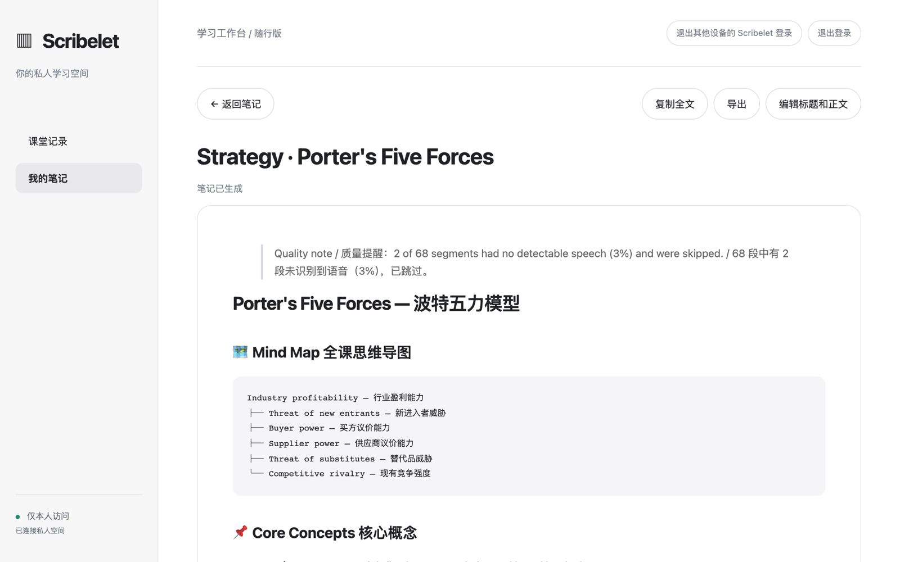
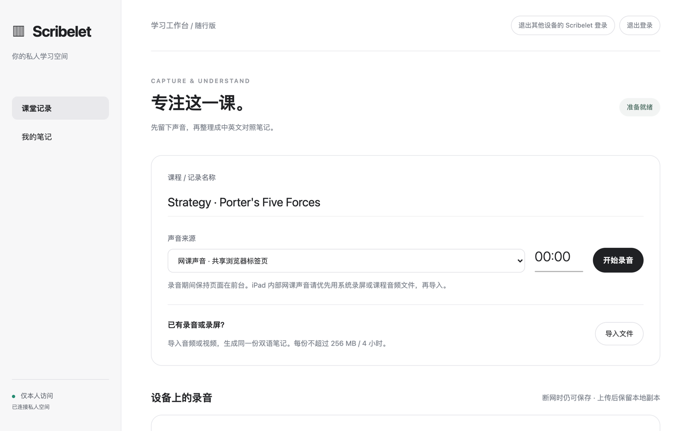

<div align="center">

# Scribelet

**录下这节课，拿到双语对照的复习笔记，数据全在自己的服务器上。**

给所有「用非母语上课」的人做的自托管课堂录音工具。<br>
浏览器里录音，一分钟都不丢；下课后整理成真正能拿来复习的双语对照笔记。西语课出英文笔记、英文课出中文笔记、日语课出韩文笔记，10 种主流语言任意互译。

[English](README.md) · [快速开始](#快速开始) · [工作原理](#工作原理) · [路线图](#路线图)



</div>

---

## 为什么做这个

用外语授课的第三周：老师讲得快，课件跳步骤，你刚查完一个词，老师已经讲到两个概念之后了。

录音软件给你一大段原文，翻译软件给你一大段译文。都不是考前那晚你要的东西。你要的是：**这节课的结构、每个要点的双语对照，还有能直接跳回没听懂那一分钟的时间索引。**

Scribelet 做的就是这个。它还默认会出事：酒店网断了、电脑睡着了、三小时的研讨课跑到一半模型额度用完了。这些都不该让你丢掉一节课。

## 下课后你拿到什么

每次录音生成一份笔记：

- **全课思维导图**：每个分支都双语对照
- **核心概念**：定义、例子、解释，逐条对照
- **分析框架或流程**：步骤、适用条件、常见误区
- **考点与复习问题**：带双语简答
- **回听索引**：按时间戳找回想重听的地方
- **待确认**：模型拿不准的内容会标出来，不编
- **完整转写**：逐段原文，每段下面跟译文

有哪段录音没识别到语音，笔记顶部会写明，不会悄悄留空。

## 任何课堂语言，任何笔记语言

录音前选两样：这节课讲的是什么语言，你想要什么语言的笔记。每台设备会记住你的选择。

**English · 简体中文 · Español · Français · Deutsch · 日本語 · 한국어 · Português · Русский · العربية**，任意两种、任意方向。不确定老师讲什么语言？选「自动识别」。两边选同一种？就出单语笔记，不走翻译，也不多花钱。

> 识别准不准取决于你接的模型。默认的 SenseVoice 支持中文、英语、日语、韩语、粤语；西班牙语、法语、德语、葡萄牙语、俄语、阿拉伯语的课，请接 Whisper 这一类模型。

## 为「不丢课」而设计

| 出了什么事 | Scribelet 怎么办 |
|---|---|
| 上课时断网 | 每约 5 秒存一次到浏览器本地，联网后分片续传 |
| 下课直接关了网页 | 下次打开页面，没传完的录音会接着上传 |
| 当天的模型额度用到一半没了 | 已完成的步骤都存了检查点，第二天从断点继续，不重复扣费 |
| 想让同一节课的笔记更好 | 用已保存的转写重新生成，不再花转写费 |
| 浏览器把老师的声音当噪音处理掉 | 关闭了回声消除、降噪和自动增益，远处讲课的声音不会被压掉 |
| 下载录音时中途断了 | 下载会声明文件长度并逐片核对，不完整的文件不会冒充完整 |

## 你的服务器，你的数据

- **只有一个主人。** 没有注册页、没有共享账号。密码用 scrypt 哈希保存，全局登录限流，有 CSRF 防护和严格的域名校验。
- **自己接 API，不绑定任何一家。** OpenAI、硅基流动、Groq、本地 Whisper + 大模型网关都行，只要提供 OpenAI 格式的 `/audio/transcriptions` 和 `/chat/completions`。想换服务商，改四行配置就行。
- **防超支。** 每天的任务数、录音时长、token 都设了上限。每次调用前先预扣，调用后按服务商实际计费退还差额。
- **真正的笔记库。** 能编辑，保留最近 20 个版本；有回收站，可以恢复，也可以彻底删除；能导入旧的 Markdown 笔记，也能导出。
- **加固过的容器。** 只读文件系统、去掉全部 Linux 权限、限制内存和进程数，Caddy 自动配 HTTPS。

<p align="center"></p>

## 快速开始

需要：一台装了 Docker 的服务器或常开的电脑，一个指向它的域名，一个模型服务的 API Key。

```bash
git clone https://github.com/howardchenghuang-dotcom/scribelet.git
cd scribelet
python3 setup_private.py      # 填域名、账号、密码、模型服务；密钥只存在这台机器上
docker compose up -d --build  # 第一次启动时 Caddy 会自动申请 HTTPS 证书
```

打开 `https://你的域名`，登录就能录音。

### 换模型服务

`setup_private.py` 会把下面这些写进 `private.env`，之后随时可以改，改完重启即可。

| 设置 | 默认值 | 含义 |
|---|---|---|
| `SCRIBELET_API_BASE` | `https://api.siliconflow.cn/v1` | 任意兼容 OpenAI 的接口地址 |
| `SCRIBELET_API_KEY` | — | 这个接口的密钥 |
| `SCRIBELET_ASR_MODEL` | `FunAudioLLM/SenseVoiceSmall` | 转写模型（OpenAI 上用 `whisper-1`） |
| `SCRIBELET_MODEL` | `Qwen/Qwen3.5-35B-A3B` | 写笔记和翻译用的模型 |
| `SCRIBELET_EXTRA_BODY` | — | 有些服务要的额外字段，例如 `{"enable_thinking": false}` |
| `SCRIBELET_DAILY_TOKENS` | `1200000` | 每天的 token 上限，够一节 4 小时的课 |

## 工作原理

- 浏览器录网课标签页的声音或麦克风，每约 5 秒存进 IndexedDB，按 2 MB 分片续传到服务器。
- 服务器用 ffmpeg 转成 16 kHz 单声道，约每 45 秒切一段，切点落在停顿里（`silencedetect`），不会把一句话切成两半。切分方案会保存下来，重试时切出完全一样的段落。
- 逐段转写，逐段翻成笔记语言，最后生成结构化的双语笔记。每一步都存检查点。
- 长课先分批整理再合并，4 小时的研讨课和 20 分钟的课走同一套流程。
- 单次录音最长 4 小时、256 MB。可以导入音频和视频，也可以导入旧的 Markdown 或纯文本笔记。

## 现状和限制

作者从 2026 年 9 月起一直在用。测试有 130 多项，覆盖上传中断、下载截断、上课途中额度用完、服务重启后续跑等情况。

需要知道的：

- **界面有英文和简体中文两种。** 默认跟随浏览器语言，右上角可以切换。笔记可以是支持的 10 种语言中的任意一种。
- **笔记是下课后出，不是实时的。** 实时字幕是下一个大功能，见下文。
- **录音时浏览器要开着。** iPad 上的浏览器录不到别的 App 的声音，要先用系统录屏，再导入文件；页面里有步骤指引。
- macOS 原生运行的脚本（launchd 服务、用 [age](https://github.com/FiloSottile/age) 加密后存到 iCloud 的异地备份）已经附上并有测试，但还没做成一步安装。目前推荐用 Docker 安装。

## 路线图

- [ ] **边听边看实时字幕**：可选，默认关闭。接本地的 [WhisperLiveKit](https://github.com/QuentinFuxa/WhisperLiveKit) 或云端流式识别。课后用完整录音生成的笔记仍然是最准的那份。
- [ ] 更多界面语言
- [ ] macOS 一步安装，含加密异地备份

## 开发

```bash
python3 -m venv .venv && .venv/bin/pip install -r requirements-dev.txt
.venv/bin/python -m pytest -q   # 服务端
npm ci && npm test              # 浏览器端行为（IndexedDB、上传队列）
```

本地不走 HTTPS 预览：设置 `SCRIBELET_LOCAL_PREVIEW=1` 和 `SCRIBELET_ORIGIN=http://127.0.0.1:8000`。

## 许可证

[MIT](LICENSE)
